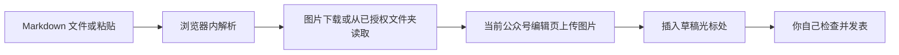

# 公众号 MD Paste

> 在微信公众号图文编辑页把 Markdown 写进草稿：正文变成带样式的 HTML，图片按原位置放入，扩展不替你点发表。

## 你能得到什么

| 场景 | 你做什么 | 结果 |
| --- | --- | --- |
| 从 AI 或编辑器拿出一篇 Markdown | 在图文编辑页拖入 `.md`，或在正文按 Ctrl+V | 标题、列表、引用、链接等写入当前光标 |
| 文中有网络图片 | 允许扩展访问图片所在网站 | 图片先下载到浏览器，再经当前公众号编辑页上传后插入 |
| 文中有相对路径图片 | 试用或 Pro 下授权一次文件夹 | 之后按相对路径自动匹配 |
| 想去掉限额和文末提示 | 在设置页粘贴 License Key | 本机校验通过后按 Pro 导入 |

安装后有 14 天完整试用。试用结束没激活时，每篇最多 3 张图片，不能授权本地文件夹，文末保留一句提示。Pro 价格是 ¥19/月或 ¥99/年，Key 上标注最多 5 台设备。

## 安装与第一次使用

1. 打开 `chrome://extensions`，打开开发者模式，选择「加载已解压的扩展程序」，选中本仓库目录。
2. 登录 [公众号后台](https://mp.weixin.qq.com/) 并打开一篇图文草稿。成功标志：编辑区右上角出现绿色的「导入 Markdown」。
3. 点开面板，把 `examples/sample.md` 拖进去。
4. 成功标志：草稿正文出现带绿色左边线的小标题和列表；页面没有自动跳到发表完成。有本地图片时，扩展会另开一个小窗口，在那里选中 `examples` 文件夹。

本地可先验证排版，不需要登录公众号：

```bash
npm test
python3 -m http.server 8765
```

浏览器打开 `http://127.0.0.1:8765/dev/preview.html`，点「导入示例」。成功标志：中间的白卡片出现标题「Markdown 导入示例」、绿色小标题和一张绿色示意图。这个页面不是公众号编辑器。

## 它怎样工作



正文支持 H1–H3、加粗、斜体、有序和无序列表、引用、链接、分割线、行内代码和表格。H4–H6 先按三级标题显示。代码块使用等宽底色，没有语法高亮。表格按带边框的表格排进正文，单元格里的加粗和链接会保留。

frontmatter 只读取 `title` 和 `cover`。标题只在输入框为空时填入，最多 64 字。`cover` 或正文第一张成功导入的图片会作为封面候选；封面区已经有图时不覆盖。

宣传页：<https://coderfather.com/wechat-markdown/>。让模型直接写出可导入的稿子时，安装 skill：

```bash
npx skills add zack6116/wechat-mp-markdown -a claude-code -a codex -g -y
```

最佳实践是把图片写成 `` 或公网 https 地址，导入时由扩展自动上传到当前公众号。压缩包也挂在宣传页上。

编辑器优先走公众号官方的 `__MP_Editor_JSAPI__`。接口不可用时，再按 `src/page/main.js` 里 2026-10-12 这组选择器写入。公众号改版后改这个文件。

激活 Key：

```bash
npm run license -- --days 365
npm run license -- --lifetime
```

把终端打印的 Key 交给购买的人。不要把 Key 提交进仓库。

## 权限 / 数据 / 隐私

| 权限 | 用途 |
| --- | --- |
| `storage` | 在本机记住试用开始时间、License Key，以及「忘记文件夹」这个标记 |
| `https://mp.weixin.qq.com/*` | 只在公众号后台注入按钮，并把图片交给当前编辑页上传 |
| 可选的 `http://*/*`、`https://*/*` | 仅当你点「允许下载网络图片」后，用来下载文中的图片地址 |

文章正文和图片不发到扩展作者的服务器。扩展不读取 Cookie；上传请求由已经打开的公众号页面发出。本地文件夹要你自己点选，句柄存在扩展自己的 IndexedDB 里。License Key 存在 `chrome.storage.local`。

更细的说明在 [PRIVACY.md](PRIVACY.md)。

## 使用边界

- 需要你已经登录公众号，并且正打开图文编辑页。扩展不登录、不发表、不群发。
- 这不是微信或腾讯的官方产品。编辑器改版后，导入可能失败，直到更新 `src/page/main.js`。
- 真实公众号编辑器上的插入和上传，这次没有在已登录后台里验收。上面的成功标志分两段：右上角按钮需要你本机打开编辑页确认；排版结果由 `npm test` 和本地预览页确认。
- 图片优先处理 JPG、PNG，也接受 GIF、WebP。超过 1MB 会提示，超过 8MB 会跳过。不下载本机、内网或带账号密码的地址，也不接收 SVG。
- 免费版限额见上。表格转图片、代码高亮、多主题和批量导入还没做。表格目前是 HTML 表格，不是图片。
- 5 台设备的限制写在 Key 里，当前版本不会联网核验。本地校验也不能防止有人从扩展包里取出算法自行生成 Key。清除扩展数据会重新计算 14 天试用。
- 你需要拥有正文和图片的使用权。扩展不判断版权。

## 许可证

尚未选择开源许可证，版权保留。可以在自己的浏览器里加载使用。未经允许，不要把代码复制到其他产品或公开发布。

## 贡献与反馈

问题和对安全问题的反馈发到 <https://x.com/zack6116>。不要在消息里附文章正文、Cookie、后台 token 或 License Key。

没有飞书交流群。购买 Key 的收款方式由作者另行约定，仓库里不放收款码。
